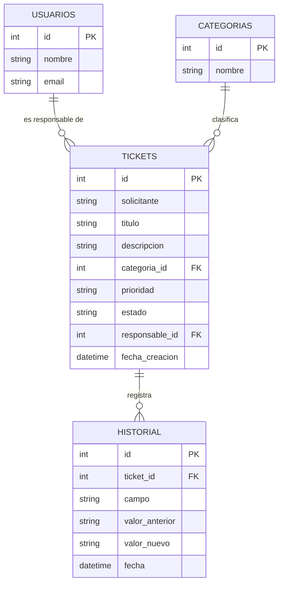

# 

Script: `schema.sql` (CHECK en prioridad y estado, claves foráneas activas).
```
-- Mesa de Soporte TI - esquema de base de datos (SQLite)
PRAGMA foreign_keys = ON;

CREATE TABLE IF NOT EXISTS usuarios (
    id     INTEGER PRIMARY KEY AUTOINCREMENT,
    nombre TEXT NOT NULL UNIQUE,
    email  TEXT
);

CREATE TABLE IF NOT EXISTS categorias (
    id     INTEGER PRIMARY KEY AUTOINCREMENT,
    nombre TEXT NOT NULL UNIQUE
);

CREATE TABLE IF NOT EXISTS tickets (
    id             INTEGER PRIMARY KEY AUTOINCREMENT,
    solicitante    TEXT NOT NULL,
    titulo         TEXT NOT NULL,
    descripcion    TEXT NOT NULL,
    categoria_id   INTEGER NOT NULL REFERENCES categorias(id),
    prioridad      TEXT NOT NULL CHECK (prioridad IN ('Crítica','Alta','Media','Baja')),
    estado         TEXT NOT NULL DEFAULT 'Nuevo'
                   CHECK (estado IN ('Nuevo','En proceso','Resuelto','Cerrado')),
    responsable_id INTEGER REFERENCES usuarios(id),
    fecha_creacion TEXT NOT NULL DEFAULT (datetime('now','localtime'))
);

CREATE TABLE IF NOT EXISTS historial (
    id             INTEGER PRIMARY KEY AUTOINCREMENT,
    ticket_id      INTEGER NOT NULL REFERENCES tickets(id),
    campo          TEXT NOT NULL,
    valor_anterior TEXT,
    valor_nuevo    TEXT,
    fecha          TEXT NOT NULL DEFAULT (datetime('now','localtime'))
);

-- Datos base
INSERT OR IGNORE INTO categorias (nombre) VALUES
 ('Hardware'),('Software'),('Red'),('Cuentas y accesos'),('Otro');
INSERT OR IGNORE INTO usuarios (nombre, email) VALUES
 ('Iván Peña','ivan@mesa.local'),
 ('Yanci Arizmendi','yanci@mesa.local');
```
